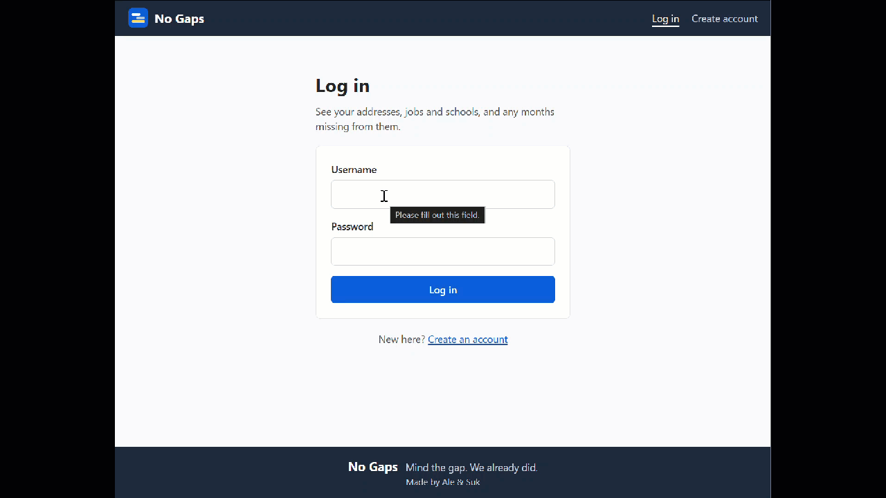
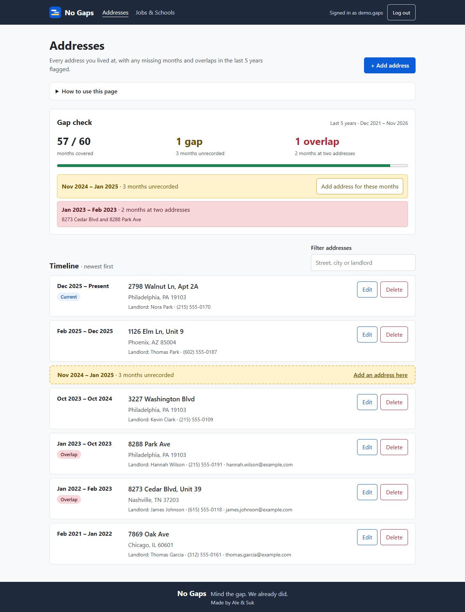

# No Gaps

Two private timelines: one for your past addresses and one for your past jobs and schools,
each with a check that flags the months you haven't recorded.





## Authors

- **Alejandra Aimee Rivas Montes**: Jobs & Schools timeline (activities collection, page, routes,
  gap check, seed), registration and the users seed.
- **Suk Jin Mun**: Address timeline (addresses collection, page, routes, seed).

## Class

[CS5610 Web Development](https://johnguerra.co/classes/webDevelopment_online_fall_2026/)

## Objective

Rental applications and green card forms ask for every address you lived at in the last few
years. Background checks ask for every job and school of the last 7 to 10 years, with no
unexplained gaps. No Gaps keeps both histories in one private place, so you never have to
rebuild them from old emails and leases again.

- Each user logs in and sees only their own entries.
- **Addresses** checks the last 5 years. Unrecorded months are listed as gaps and months with two
  addresses are listed as overlaps. A move inside one month is not an overlap.
- **Jobs & Schools** checks the last 10 years. Each month is covered (job or school),
  explained (an "other activity" such as caregiving or travel) or unrecorded. Unrecorded months
  are listed as gaps, and one click starts an entry that fills them.
- Working and studying at the same time is normal and is never flagged.

The app organizes what you enter; it doesn't verify it.

## Demo

- Deployed app: [DEPLOYED URL]
- Video: [VIDEO URL]
- Slides: [Google Slides](https://docs.google.com/presentation/d/1r8hK2WlgtJ56rmtv6cy-PEECMXk2hrNlZG-sYHmKLh0/edit?usp=sharing)

Demo accounts (password `nogaps-demo`):

| Account | Jobs & Schools | Addresses |
| --- | --- | --- |
| `demo.gaps` | Two 3-month gaps and an 18-month explained period | A 3-month gap and a 2-month overlap |
| `demo.complete` | No gaps; school and a part-time job overlap | No gaps and no overlaps |
| `demo.explained` | A break covered by an explained period | No gaps and a 3-month overlap |
| `demo.empty` | An empty history | An empty history |

## Tech stack

- Frontend: React 18 with hooks, React Router and Vite, using `fetch`.
- Backend: Node.js and Express (ES modules) with the native MongoDB driver.
- Login: Passport (passport-local) with express-session; sessions are stored in MongoDB and
  passwords are hashed with bcrypt.
- No Mongoose, axios or CORS package.

## Build and run

Requirements: Node.js 20.6 or newer and a MongoDB database (local or
[MongoDB Atlas](https://www.mongodb.com/atlas)).

```bash
# 1. Backend
cd backend
npm install
cp .env.example .env   # then set MONGO_URI and SESSION_SECRET
npm run seed           # demo accounts, 200 synthetic users, 1,200+ activities, 1,000+ addresses
npm run dev            # API on http://localhost:3000

# 2. Frontend (second terminal)
cd frontend
npm install
npm run dev            # app on http://localhost:5173 (sends /api to the backend)
```

Production build: run `npm run build` in `frontend`, then `npm start` in `backend` with
`NODE_ENV=production`. Express serves the built app from `frontend/dist`.

Other scripts (both folders): `npm run lint` (ESLint) and `npm run format` (Prettier).
`npm test` in `backend` runs the tests with Node's built-in test runner.

## Project structure

```
backend/
  auth/          Passport setup and the login check
  controllers/   route handlers (activities, register)
  db/            MongoDB connection and one file per collection
  routes/        Express routers
  seed/          synthetic data scripts
  utils/         gap check, validation, month helpers
  tests/
frontend/src/
  api/           fetch helpers
  components/    one component per file, each with its own CSS file
  pages/
  utils/
```

## API

All `/api/activities` and `/api/addresses` routes need a logged-in session and only touch that
user's entries.

| Method | Route | Does |
| --- | --- | --- |
| POST | `/api/register` | Create an account |
| POST | `/api/login` | Log in |
| POST | `/api/logout` | Log out |
| GET | `/api/me` | Who is logged in |
| GET | `/api/activities` | List my jobs, schools and other activities |
| GET | `/api/activities/gaps?years=10` | Covered, explained and unrecorded months, the list of gaps, and a `timeline` of segments (each with its months and the ids of the activities that cover it; no ids means a gap). `years` can be 5, 7 or 10 |
| POST | `/api/activities` | Add one |
| PUT | `/api/activities/:id` | Edit one of mine |
| DELETE | `/api/activities/:id` | Delete one of mine |
| GET | `/api/addresses?q=` | List my addresses with the 5-year check of gaps and overlaps. `q` filters the list by street, city or landlord |
| GET | `/api/addresses/:id` | Read one of mine |
| POST | `/api/addresses` | Add one |
| PUT | `/api/addresses/:id` | Edit one of mine |
| DELETE | `/api/addresses/:id` | Delete one of mine |

## License

[MIT](LICENSE)
