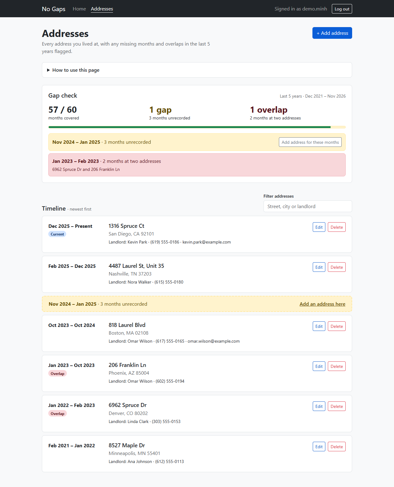

# No Gaps

No Gaps keeps your past addresses, jobs and schools in one place and flags every missing month.

## Authors

Suk Jin Mun (address timeline) and Alejandra Aimee Rivas Montes (jobs and schools timeline)

## Class link

[CS5610 Web Development, Northeastern University](https://johnguerra.co/classes/webDevelopment_online_fall_2026/)

## Objective

Rental applications and green card forms ask for every address of the last few years. Each user logs in and keeps a private timeline of addresses with their months and landlord contacts. The gap check lists the months of the last 5 years with no address and the months with two addresses.

## Screenshot

## Instructions to build

1. Install Node 22.12 or later.
2. In `backend`, run `npm install`, copy `.env.example` to `.env`, and set `MONGODB_URI` and `SESSION_SECRET`.
3. In `backend`, run `npm run seed:addresses` once. It gives each user in the `users` collection 5 to 8 synthetic addresses, more than 1,000 in total.
4. In `frontend`, run `npm install` and `npm run build`.
5. In `backend`, run `npm start` and open http://localhost:3000.
6. To develop, run `npm run dev` in `backend` and in `frontend`, and open http://localhost:5173.
7. Run `npm run lint` in each folder and `npm test` in `backend`.

## License

Released under the [MIT License](LICENSE).
