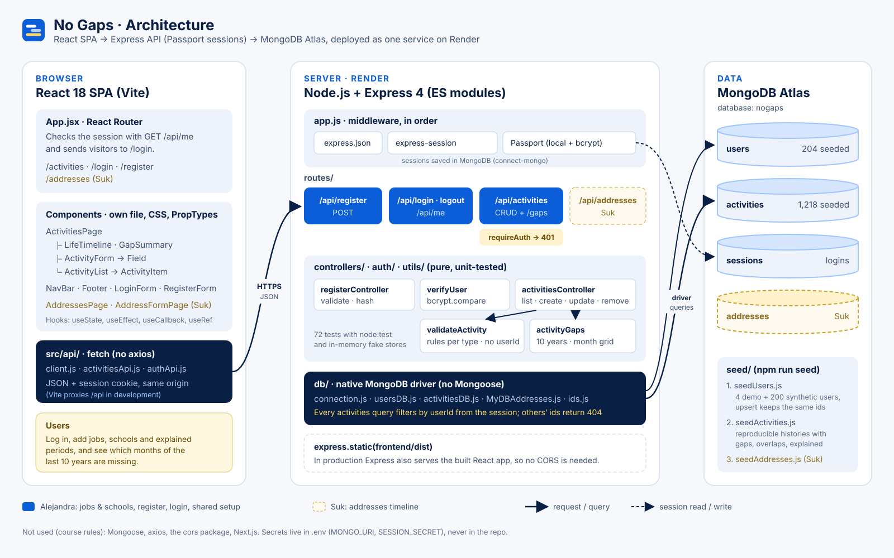
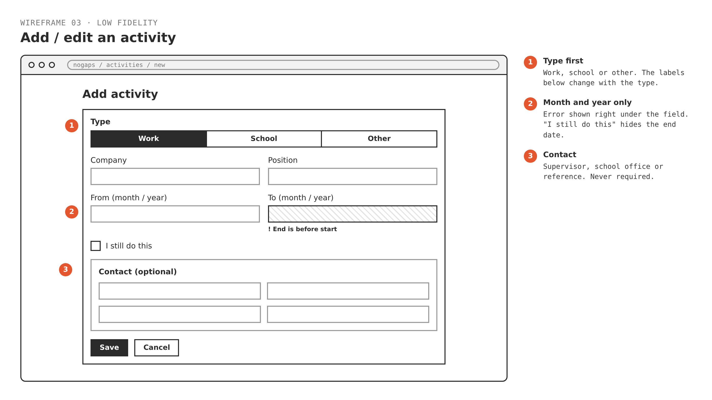

# No Gaps: Design Document

CS5610 Web Development, Northeastern University, Fall 2026.
Authors: Alejandra Aimee Rivas Montes and Suk Jin Mun.

## 1. Project description

Rental applications, green card forms and background checks ask for a full history: every
address you lived at, and every job and school of the last 7 to 10 years, with no unexplained
gaps. People rebuild that history from old emails, leases and pay stubs every time they fill in
a new form.

No Gaps keeps two private histories in one place:

- **Addresses** (Suk): past homes with their dates.
- **Jobs & Schools** (Alejandra): past jobs, schools and "other" periods such as caregiving or
  travel, with dates and an optional supervisor or contact.

Each history marks the months that have no record. The app organizes what the user enters; it
does not verify anything.

Each history works and is graded on its own. The Jobs & Schools part never reads the addresses
collection, and the other way around.

## 2. User personas

### Marcus, new hire

- Just accepted a job offer at a company that runs a background check.
- The check asks for 7 years of jobs and schools, with a supervisor for each job.
- Has changed jobs three times and studied part-time; doesn't remember the exact months.
- Wants to write everything down once and copy it into the form.

### Grace, federal job applicant

- Applying for a federal position.
- Her form asks for 10 years of history with no unexplained gaps.
- Took a break to care for a family member and spent some months between jobs.
- Wants to see at a glance which months are missing before she submits.

## 3. User stories

1. As Marcus, I want to add each job and school with its dates and supervisor, so I have
   everything the background check asks for in one place.
2. As Grace, I want to see my last 10 years with the missing months marked, so I can fill or
   explain them before I submit my form.
3. As Marcus, I want to edit or delete a job or school, so my history stays correct when I find
   the real dates.

Supporting stories:

- As a new user, I want to create an account and log in, so only I can see my history.
- As Grace, I want to explain a break (for example, caregiving) so those months don't show up as
  missing.
- As Grace, I want to click a missing period and start an entry with its dates already filled in.

## 4. Gap rules

These rules were agreed by both authors and apply to both histories.

- Dates have month precision, in `YYYY-MM` format. The start and end months both count as
  covered.
- A record marked as current (`isCurrent: true`) runs to the current month and has no end month.
- The checked range is the last 10 years, including the current month. The API also accepts 5
  or 7 years.
- Each month in the range is **covered** (a job or school), **explained** (only an "other"
  activity) or **unrecorded**. Consecutive unrecorded months form a gap.
- Overlaps are normal (working and studying at the same time) and are never flagged.
- A gap is shown as "months unrecorded", never as an error or a failure.

## 5. Data model

MongoDB with the native driver (no Mongoose). Every activity belongs to one user, and every
query filters by that user's id.

### `users`

| Field | Type | Notes |
| --- | --- | --- |
| `_id` | ObjectId | |
| `username` | string | Unique index |
| `passwordHash` | string | bcrypt hash; never sent to the browser |
| `createdAt` | Date | |
| `seed` | boolean | Only on seeded accounts |

### `activities`

| Field | Type | work | school | other |
| --- | --- | --- | --- | --- |
| `userId` | ObjectId | from the session | same | same |
| `type` | `"work"`, `"school"` or `"other"` | | | |
| `organization` | string | required | required | optional |
| `title` | string | position | program | explanation |
| `startMonth` | `YYYY-MM` | required | required | required |
| `endMonth` | `YYYY-MM` or null | required unless current | same | same |
| `isCurrent` | boolean | | | |
| `contact` | `{ name, role, phone, email }` | optional | optional | optional |
| `notes` | string | optional | optional | optional |
| `createdAt`, `updatedAt` | Date | | | |

The end month can't be before the start month. Several current records are allowed at once.
Index: `{ userId: 1, startMonth: 1 }`.

## 6. Architecture



- In development, Vite forwards `/api` to the backend, so no CORS package is needed.
- In production, Express serves the built React app from `frontend/dist`.
- The server is the only source of the gap check. After each save or delete, the page asks
  the server for the list and the gap summary again instead of computing gaps in the browser.

### API

All `/api/activities` routes need a session and only touch the logged-in user's records.

| Method | Route | Does |
| --- | --- | --- |
| POST | `/api/register` | Create an account (409 if the username is taken) |
| POST | `/api/login` | Log in |
| POST | `/api/logout` | Log out |
| GET | `/api/me` | Who is logged in (401 if nobody) |
| GET | `/api/activities` | List my activities, newest first |
| GET | `/api/activities/gaps?years=10` | Month counts, gaps and timeline segments |
| POST | `/api/activities` | Add one (201, or 400 with `{ errors }`) |
| PUT | `/api/activities/:id` | Edit one of mine (404 if it isn't mine) |
| DELETE | `/api/activities/:id` | Delete one of mine (204, or 404) |

The gaps response (shortened; `coveredMonths` includes the explained months):

```json
{
  "range": { "start": "2016-12", "end": "2026-11", "years": 10 },
  "totalMonths": 120,
  "coveredMonths": 114,
  "explainedMonths": 18,
  "unrecordedMonths": 6,
  "gaps": [{ "start": "2019-03", "end": "2019-05", "months": 3 }],
  "timeline": [
    { "start": "2016-12", "end": "2019-02", "months": 27, "activityIds": ["..."] },
    { "start": "2019-03", "end": "2019-05", "months": 3, "activityIds": [] }
  ]
}
```

`timeline` splits the range into consecutive segments that share the same activities. A
segment with no ids is a gap.

## 7. Interface design

### Jobs & Schools page, top to bottom

1. **Header**: logo, "No Gaps", navigation and "Log out".
2. **Title** and the "+ Add activity" button.
3. **"Your last 10 years" timeline**: a horizontal bar of the whole range.
   - Each segment's width is proportional to its months, with a 12 px minimum so a one-month
     gap stays visible.
   - Colors match the activity type. Overlapping types are shown as a gradient. Gaps use the
     yellow from the logo.
   - Hovering shows the period and the activities (or "N months unrecorded").
   - Clicking a gap opens the form with its dates filled in. Clicking an activity scrolls to
     it in the list and highlights it.
4. **"How to use this page"**: a collapsible help section.
5. **Gap check**: months covered, number of gaps, months explained, a bar with the recorded and
   unrecorded percentages, and the list of gaps with an "Add activity for these months" button.
6. **Form** (when open): add or edit an activity.
7. **Timeline list**: every activity, newest first, with Edit and Delete (Delete asks to
   confirm).
8. **Footer**: "No Gaps · Mind the gap. We already did." and "Made by Ale & Suk".

Screenshot of the built page: [screenshot.gif](screenshot.gif).

### Design mockups

Low-fidelity wireframes drawn before building the Jobs & Schools timeline. The numbered notes
on each one explain the design decisions.

#### Wireframe 01: Log in and create account


1. **One simple form.** Only username and password. Errors appear above the form.
2. **Easy switch.** A link goes between log in and create account.
3. **Password rules.** The rule (at least 8 characters) shows before the user types. The
   server hashes the password with bcrypt.
4. **Private.** Every page except these two needs a session.

#### Wireframe 02: Jobs & Schools timeline


1. **Add button.** Always visible at the top of the page.
2. **10-year bar.** The history is drawn as one bar so gaps (hatched) stand out. Overlaps go on
   a second row.
3. **List, newest first.** Gaps sit between entries with a button to fill them.
4. **Open question.** Bar or summary numbers? To be tested with users.

#### Wireframe 03: Add or edit an activity



1. **Type first.** Work, school or other. The labels below change with the type.
2. **Month and year only.** Errors show right under the field. "I still do this" hides the end
   date.
3. **Contact.** Supervisor, school office or reference. Never required.

#### Wireframe 04: Phone layout


1. **Summary first.** The 10-year bar and the gap count stay at the top.
2. **Big touch targets.** Buttons are at least 44 px; the add button spans the full width.
3. **Menu.** Links collapse into a ≡ menu on small screens.

### From mockups to the built app

- **Bar and numbers.** The open question in wireframe 02 was settled by keeping both: the
  "Your last 10 years" timeline at the top, and the "Gap check" card with the numbers below it.
- **Overlaps.** Instead of a second row, overlapping types share one segment drawn as a
  gradient of their colors.
- **Color.** The grey wireframe bar became colors per type (work, school, other), with gaps in
  the logo's yellow instead of hatching.
- **Gaps.** Gaps are listed in the Gap check card with an "Add activity for these months"
  button, and can also be filled by clicking them on the timeline, instead of sitting between
  entries in the list.
- **Menu.** The header links wrap onto a second line on small screens instead of collapsing
  into a ≡ menu.

### Colors

| Use | Color |
| --- | --- |
| Header and footer background | `#1E293B` |
| Header and footer main text | `#FFFFFF` |
| Header and footer secondary text | `#CBD5E1` |
| Work | `#0B5ED7` |
| School | `#198754` |
| Other (explained) | `#0AA2C0` |
| Gap (months unrecorded) | `#FFD966` |

All colors are CSS variables in `frontend/src/index.css`.

### Accessibility

- Semantic HTML: `<button>`, `<form>`, `<label htmlFor>`, `<nav>`, `<header>`, `<footer>`.
  No `div` or `span` with an onClick.
- Field errors use `role="alert"` and appear next to each field.
- Touch targets are at least 44 px. The layout works at 390 px wide.
- Every timeline segment is a button with a full `aria-label`. The gap list below the
  timeline offers the same actions with larger targets.

## 8. Security and privacy

- Passwords are hashed with bcrypt. `passwordHash` is never returned to the browser.
- Sessions are stored in MongoDB. The cookie is `httpOnly` and `sameSite=lax`, and `secure` in
  production.
- `userId` always comes from the session (`req.user._id`), never from the request body.
  Validation drops any `userId` the browser sends.
- Every activity query filters by `userId`. Editing or deleting someone else's record returns
  404.
- Credentials live in `backend/.env`, which is not committed.

## 9. Testing and seed data

- Tests use Node's built-in runner (`npm test` in `backend`) with fake in-memory data layers.
  They cover the gap rules, the timeline segments, validation, privacy, registration, login and
  the seed.
- `npm run seed` creates 4 demo accounts, 200 synthetic users and more than 1,000 activities.
  It can be run again without duplicating data.

Demo accounts (password `nogaps-demo`):

| Account | Shows |
| --- | --- |
| `demo.gaps` | Two 3-month gaps and 18 explained months |
| `demo.complete` | No gaps; school and a part-time job overlap |
| `demo.explained` | A break covered by an explained period |
| `demo.empty` | An empty history |

## 10. Tech stack

- Frontend: React 18 with hooks, React Router 6, Vite 5, `fetch`, PropTypes, custom CSS.
- Backend: Node.js 20.6+, Express 4, native MongoDB driver 6.
- Login: Passport (passport-local), express-session, connect-mongo, bcrypt.
- Tooling: ESLint and Prettier.
- Not used, by design: Mongoose, axios, the `cors` package, Next.js.
